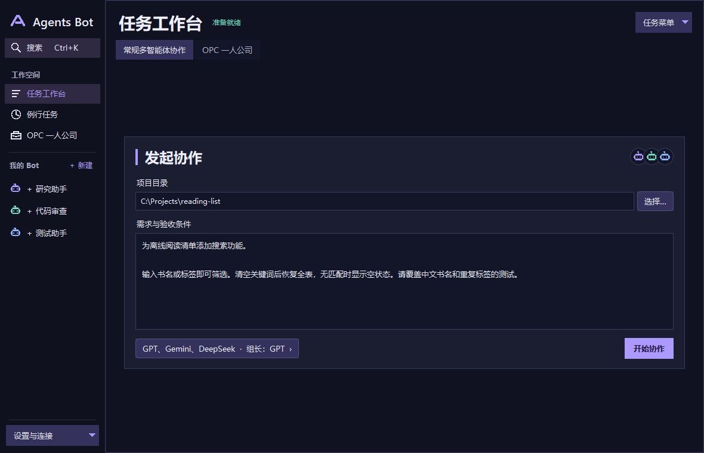
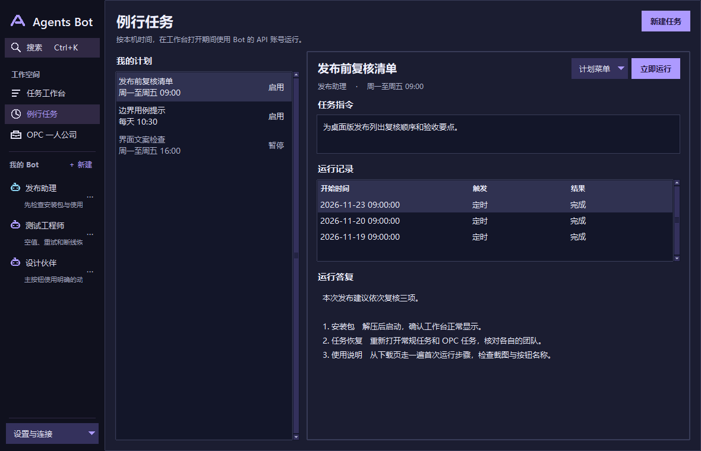
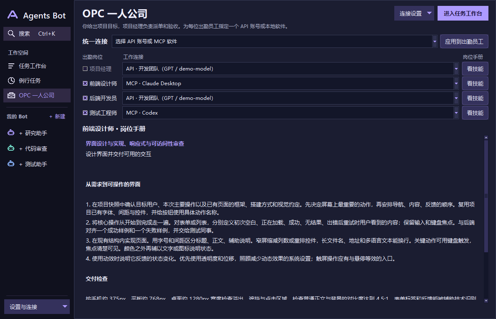
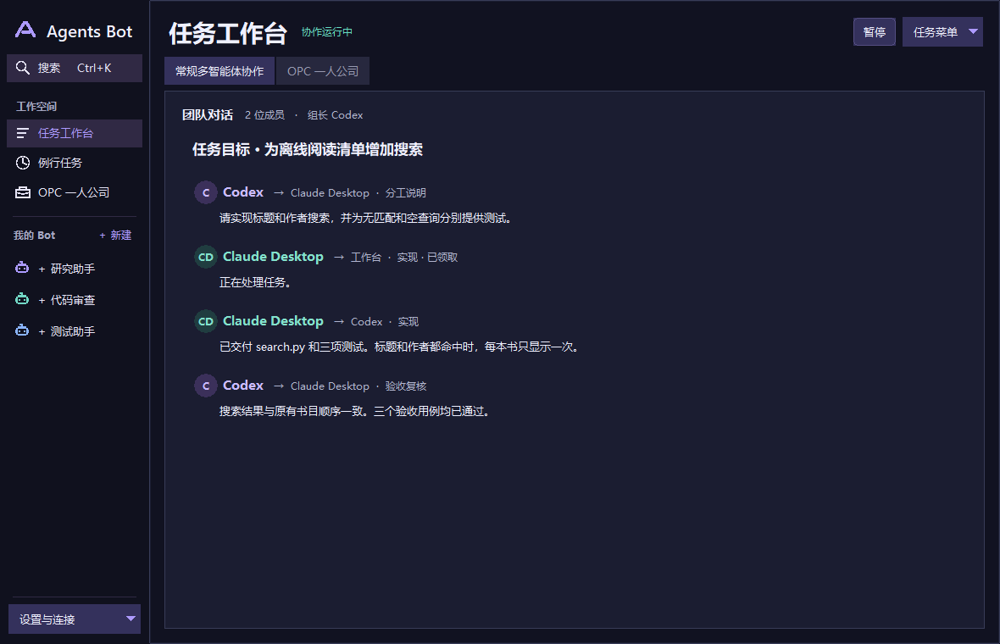
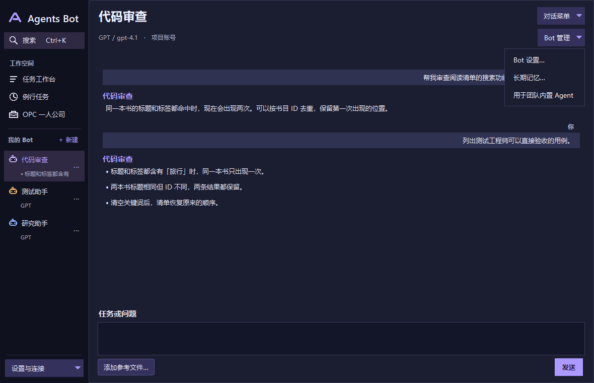

# Agents Bot

**开源版 GrokBot（独立实现，非官方）。** Agents Bot 是一个 Windows 多智能体开发工作台。新建任务时选择 **常规多智能体协作** 或 **OPC 一人公司**。两种模式都能使用 API 账号和本地 MCP 软件，在团队对话中查看分工、草稿、交接和验收结果。

[下载 Windows x64 便携包](https://github.com/rrship/agents-bot/releases/download/v1.8.0/AgentsBot-v1.8.0-Windows-x64.zip) · [下载源码 ZIP](https://github.com/rrship/agents-bot/releases/download/v1.8.0/AgentsBot-v1.8.0-source.zip) · [下载安卓监控端 1.1（Android 8.0+）](https://github.com/rrship/agents-bot/releases/download/v1.8.0/AgentsBot-Android.apk) · [v1.8.0 发布说明](https://github.com/rrship/agents-bot/releases/tag/v1.8.0)

## v1.8.0 工作台

解压便携包并双击 `AgentsBot.exe`。在墨蓝色工作台选模式、项目目录，写下目标，点紫色的「开始协作」。开工后，中央区域显示团队对话，暂停或继续按钮随任务状态出现。



| 要做什么 | 从哪里打开 |
| --- | --- |
| 配置模型、桌面软件、SSH 或手机 | 侧栏左下「设置与连接」，选择对应页面 |
| 载入已有任务、添加验收命令、查看交付 | 工作台右上「任务菜单」 |
| 为 Bot 设置职责或长期记忆 | 侧栏点 Bot 名称，再点「Bot 管理」 |
| 调整定时任务 | 侧栏「例行任务」，选中任务后点「计划菜单」 |

| 工作模式 | 你决定什么 | 团队如何工作 |
| --- | --- | --- |
| 常规多智能体协作 | 自选模型、桌面软件或内置 Agent 组队，可指定任意一位成员当组长 | 选「平等协作」让成员分工互审，或选「组长统筹」由组长派单和复核。支持本地项目及 SSH 云房间。[常规团队入门](#完成第一个本地任务) |
| OPC 一人公司 | 以老板身份定目标和验收条件，选择出勤岗位，为每个岗位指定连接 | 项目经理固定负责派单和验收，前端、后端、测试员工按各自的内置技能手册，在本机工作台交付。各岗位可以共用一个账号或一款软件。[OPC 入门](#用一个账号开一人公司) |

在工作台顶部选择团队模式。每个任务保留创建时的模式。用「任务菜单 → 载入任务…」打开旧项目，会回到原有的协作方式。要尝试另一种方式，可以在新任务中重新选择。[选择模式与恢复任务](使用说明.md#选择工作模式)

## 让 Bot 记住约定并定时工作



1. 从侧栏「我的 Bot」新建一个测试助手，选择它的 API 账号。打开「Bot 管理 → 长期记忆…」，保存「本项目的验收清单必须覆盖中文输入、空数据和断网」。此后与它私聊时，助手会收到这项约定。重新打开工作台还能接着最近 50 轮完整私聊继续工作。[Bot 对话与长期记忆](使用说明.md#我的-bot)
2. 打开「例行任务」→「新建任务」，选测试助手，把周期设为「周一至周五」、本机时间设为 `09:00`，填写「列出今天做桌面回归测试前要准备的五项检查」。保存后可点「立即运行」，在「运行记录」里打开这次答复。每次执行使用 Bot 的 API 额度，定时执行期间需要电脑联网、工作台保持打开。[例行任务设置](使用说明.md#例行任务)
3. 在主窗口按 **Ctrl+K** 或点侧栏「搜索」。输入 Bot 名可进入私聊，输入项目名或任务标题可回到最近的常规或 OPC 任务。首次找回旧版任务时，先用「任务菜单 → 载入任务…」选择任务目录。[搜索工作区](使用说明.md#搜索工作区)

## 用一个账号开一人公司

1. 完整解压 Windows 便携包，双击 `AgentsBot.exe`。打开「OPC 一人公司」→「连接设置 → 配置 API 账号」→「账号管理 → 新建 API 账号…」，填写服务商、模型 ID 和 API Key。已保存的账号可以直接选用。
2. 回到 OPC 页，从「统一连接」选该账号，点「应用到出勤员工」。点某个岗位旁的「看技能」可以阅读它实际收到的手册。希望由本机软件担任某个岗位时，在这一行选 `MCP · 软件名`，按「连接设置 → 连接本地软件」的指引配置。
3. 点「进入任务工作台」，选目录，给出目标，例如「做一个离线记账本，可以记收支、按月汇总、导出 CSV，并验证空账本和负数输入」。点「开始协作」后到团队对话里看派单和交付。使用 MCP 的岗位还需在对应软件中发送「复制领取指令」。



岗位行为来自随包内置的中文技能手册。项目经理和工程岗位的方法改编自 Matt Pocock 的工程技能，前端岗位另外使用 GitHub Awesome Copilot 的界面实现和审查方法。运行时会把当前员工的技能、项目资料和分工一起传给所选连接。[OPC 操作指南](使用说明.md#opc-一人公司) · [技能文件、上游版本和许可](opc_skills/README.md)

## 第一次让两个软件合作



1. 打开「设置与连接 → 软件协作」，在「配置软件」中依次选 Codex 和 Claude Desktop，分别点「接入选项 → 写入 MCP 配置」。按提示重新打开 Codex 会话，完全退出并重开 Claude Desktop。
2. 点「用 Codex 和 Claude 组队」，工作台会把 Codex 设为组长。选一个项目目录，输入「做一个离线阅读清单，并用示例验证添加和搜索」，点「开始协作」。
3. 回到「软件协作」，分别选择两款软件，点「复制领取指令」，粘贴到对应软件的对话里发送。回到「任务工作台」即可看到 Codex 给谁派单、Claude Desktop 交回了哪些文件，以及组长的验收结果。

想让工作台主动派单，可以在开始前为 Codex 选择「App Server 独立会话」，或为 DeepSeek Harness 选择「原生插件」。通过 MCP 加入的现有会话由用户发送领取指令后开始工作。[各软件的接单方式](使用说明.md#软件协作)

没有 MCP 的软件也能参加。选「其他 Harness」，在软件协作页点「手动交接 → 领取并复制任务」，把软件的完整 JSON 答复粘贴回工作台即可继续。[各软件接法与手动交接](使用说明.md#软件协作)

## 从侧栏创建一个 Bot



1. 在「我的 Bot」点「＋ 新建」。首次使用时也可直接点「代码审查」「研究助手」或「测试助手」作为起点。
2. 给它起名，选择模型账号，写下它的职责。例如给代码审查 Bot 填入「逐条列出文件名、风险和修改建议」。首次使用可在此处点「新建账号…」配置服务商、模型 ID 和 API 密钥。
3. 保存后点侧栏的 Bot 名称即可对话。点名字旁的「⋯」或「Bot 管理 → Bot 设置…」可编辑名称、职责和账号。已保存 Bot 的文字私聊及长期记忆可以跨次使用。附件与生成的文件草稿保留在当前窗口，需要留存时点「对话菜单 → 导出草稿…」。
4. 想让它参与团队，打开这个 Bot，点「Bot 管理 → 用于团队内置 Agent」，再到「成员与连接」勾选队友。要让它领队，选「组长统筹」，将「内置 Agent」设为组长。团队有一个内置 Agent 席位，你可以从侧栏选择另一位 Bot 并重新绑定。[Bot 设置与团队绑定指南](使用说明.md#我的-bot)

| 你想做什么 | 从哪里开始 |
| --- | --- |
| 带一个懂产品、设计、开发和测试的 AI 小团队 | [用一个账号开一人公司](#用一个账号开一人公司) |
| 把已经打开的软件会话拉进同一个项目 | [连接桌面软件](#第一次让两个软件合作) |
| 只有一个 API Key，想直接分析文件或生成草稿 | [使用内置 Agent](#使用内置-agent) |
| 在一台电脑上试用两个模型 | [完成第一个本地任务](#完成第一个本地任务) |
| 和异地队友共用项目，或关掉电脑后让 API 成员继续工作 | [加入云服务器房间](#加入云服务器房间) |
| 在手机上查看进度 | [绑定安卓手机](#绑定安卓手机) |

## 使用内置 Agent

1. 打开「设置与连接 → 内置 Agent 与账号」→「账号管理 → 新建 API 账号…」。填写账号名称、模型服务和该账号可用的模型 ID，再填 API Key 或环境变量名。点「保存」。同一服务商可以分别保存个人和工作账号。
2. 选好账号，在「任务或问题」输入要求并点「发送」。例如，点「添加参考文件…」选择一份费用明细 JSON，再输入「按类别汇总金额，列出缺少类别的记录，生成 summary.md」。Agent 可以列出、读取和搜索提供的文本。答复显示在页内，生成的文件用「对话菜单 → 导出草稿…」保存到新目录。
3. 想让它参与原有的多人团队，展开「账号管理」，点「用于团队内置 Agent」，再到「成员与连接」选其他成员及组长。也可点「用于同名模型成员」，为已有的 GPT、Gemini 等成员指定档案。独立对话切换账号后，原账号的本次对话和草稿可切回查看。

已有多把密钥时，可以将账号写在同一个 JSON 文件里。下面的示例从环境变量读取 DeepSeek 密钥。先设置 `DEEPSEEK_API_KEY` 并重新打开工作台，把 `your-model-id` 换成账号已开通的模型 ID，再将内容保存为 UTF-8 的 `accounts.json`，点「账号管理 → 导入账号 JSON…」选中它。

```json
{
  "version": 1,
  "accounts": [
    {
      "name": "项目 DeepSeek",
      "provider": "DeepSeek",
      "model": "your-model-id",
      "key_env": "DEEPSEEK_API_KEY"
    }
  ]
}
```

账号管理器只保存环境变量名。直接填写 API Key 时，工作台使用 Windows 当前用户的 DPAPI 加密保存密钥。要把费用明细等业务 JSON 交给模型分析，请在对话中点「添加参考文件…」。[账号 JSON 格式与完整操作](使用说明.md#内置-agent-与账号管理)

## 完成第一个本地任务

1. **启动。** 将 Windows 便携包完整解压到可写目录，双击 `AgentsBot.exe`。包内自带 Python 和 Tk。
2. **接入成员。** 在「成员与连接」勾选至少两位成员。六家模型和内置 Agent 可以组成最多七人的团队。例如，GPT 可以选「账号登录」，先安装 Codex CLI，再点「登录账号…」。DeepSeek 可以选「API Key」，填写模型 ID 和密钥。在这两个成员页分别点「测试连接」，确认两位成员都能回复。[六家模型的账号客户端和密钥配置](使用说明.md#选择团队和模型)
3. **选择协作方式。** 想让 GPT 派单和验收，就选「组长统筹」，将 GPT 设为组长；想让成员先商量接口、再并行实现和互审，就选「平等协作」。
4. **给团队一个可验收的小任务。** 在「任务工作台」点「选择…」，选一个空目录。把下面这段复制到「需求与验收条件」：

   > 用 Python 标准库写一个离线命令行待办工具。运行 `python todo.py add 买牛奶` 后，退出并重新运行 `python todo.py list` 仍能看到“买牛奶”。请提供自动化测试，以及使用临时目录验证这个过程的 `smoke.py`。

5. **运行并查看交付。** 展开「任务菜单 → 自动验收命令」，在「构建或测试命令」填 `["python","-m","unittest","discover","-v"]`，在「启动冒烟检查」填 `["python","smoke.py"]`。点「开始协作」，在「团队对话」查看分工、修改和检查结果。结束后点「任务菜单 → 交付目录」取回文件，点「任务菜单 → 改动差异」审查修改。两栏命令都留空时，交付会标记为「待人工验收」。

成员在实现阶段可以把已完成的文件、接口决定和剩余工作一起交给下一位。工作台也会在上下文首次超过字符预算且有接手人时自动交接。可以在协作记录中查看原因，暂停后用「继续」恢复。[上下文交接说明](使用说明.md#上下文交接)

## 加入云服务器房间

准备一台可通过 SSH 登录的 Linux 服务器，安装带 SQLite 和 HTTPS 支持的 Python 3.11 或更新版本。异地队友使用同一个受信任的项目 SSH 账号，每人可以使用自己的 SSH 密钥。两台电脑都能访问服务器的 SSH 端口即可协作。

1. **发起人创建房间。** 在「成员与连接」选好整个团队，在「任务工作台」写目标。打开「设置与连接 → 云服务器」，填写服务器、端口和 SSH 用户，点「连接」。首次登录时核对主机指纹，密码在 OpenSSH 窗口输入。点「从工作台创建房间」→「房间操作 → 复制房间号」，把房间号发给队友。
2. **队友加入并提供成员。** 连接同一服务器和项目账号，输入房间号，点「加入」。在「本次提供的成员」勾选自己负责的模型。用本机已登录的账号时点「本机参与」，并保持电脑在线；希望关机后继续时，选用 API Key 的成员，点「运行选项 → 启动服务器 API」。确认后，服务器进程通过 SSH 接收所选密钥，并使用相应 API 额度。
3. **取回结果。** 在房间查看分工、交接和已提交文件，点「房间操作 → 导出文件…」保存到新的本地目录。云房间面向小型文本项目，组长可在云端审阅交付，构建和测试命令在导出后本地执行。[服务器准备、文件大小限制与断线恢复](使用说明.md#云服务器协作)

## 绑定安卓手机

1. 点电脑左下角的「设置与连接 → 手机监控」，手机打开配套安卓应用，点「扫码绑定」并扫描电脑上的二维码。同一可信 Wi-Fi 下可直接配对。
2. 外出使用移动数据时，让手机和电脑加入同一个 Tailscale 私有网络。确认电脑配对界面显示「可跨网」。原来通过局域网配对的手机，需要切换到 Tailscale 地址后重新扫码。
3. 查看云任务时，在已加入房间的电脑勾选「手机显示此房间」。手机通过这台电脑获取更新，查看期间请保持工作台和 SSH 会话在线。已启动的服务器 API 成员可以在电脑关机后继续工作。[配对、跨网查看与解绑](手机监控.md)

## 从源码运行

使用带 Tk 的 Python 3.11 或更新版本，在项目目录运行 `python app.py`。运行自动测试使用 `python -m unittest discover -v`。测试使用模拟模型回复，真实账号或密钥可在工作台用「测试连接」核验。[完整中文使用说明](使用说明.md)

### 后续开发方向

常规协作侧重模型和软件接入、自由组队、组长调度与 SSH 云房间。OPC 侧重员工岗位、技能手册、岗位分工与项目经理验收。提交需求或问题时可注明所属模式。账号管理、MCP 任务收发、任务保存与交付检查属于共用能力，改动时应分别用一个常规任务和一个 OPC 任务验证。

## 项目参考

本版参考 Rakazo 把持久 Bot 和例行任务集中在同一个工作区的交互。Agents Bot 的工作区搜索、私聊记忆和本机调度均用 Python 与 Tk 独立实现。[参考版本与界面示例](https://github.com/elie222/rakazo/tree/07fb32de7ab9f35bd8c57479e702349a0846457f#features)

「团队对话」参考了 ClawChat 将多个 AI 放进同一个项目群聊的交互。工作台用发件人、接收人和任务阶段串起派单、接手、交付和验收。[ClawChat](https://github.com/Lenka0605/ClawChat)

内置 Agent 借鉴 Pi 的小型工具循环，通过现有模型适配器按需读取共享文本。多账号选择和 JSON 导入的交互参考 Cockpit Tools，账号文件使用 Agents Bot 自己的格式。[Pi coding agent](https://github.com/earendil-works/pi/tree/main/packages/coding-agent) · [Cockpit Tools](https://github.com/jlcodes99/cockpit-tools)

成员交接参考 [crew](https://github.com/dichovsky/crew)，分工与独立验收参考 [multi-agent-collaboration](https://github.com/Gambler134201/multi-agent-collaboration)。DeepSeek Harness 账号可通过本机命令派单并等待回复。[dsh-baton](https://github.com/JialaoLiu/dsh-baton)

云房间借鉴 HUD 将任务环境与模型连接分开的设计，SSH 房间、任务领取和上下文交接由本项目实现。[hud-evals/hud-python](https://github.com/hud-evals/hud-python)

安卓扫码与电脑端二维码分别使用 [ZXing Core](https://github.com/zxing/zxing) 和 [Project Nayuki QR Code generator](https://www.nayuki.io/page/qr-code-generator-library)。

## 许可证

Agents Bot 原创代码采用 MIT 许可证，允许修改、分发和商用，须保留版权声明及许可文本。第三方组件沿用各自的许可。[项目许可证](LICENSE) · [岗位技能及第三方许可](opc_skills/README.md)
