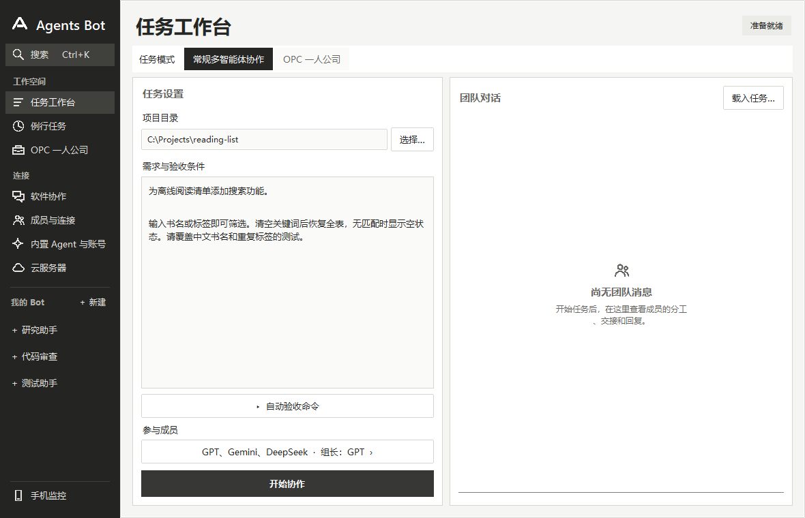

# Agents Bot 使用说明

将 Windows x64 便携包完整解压到固定、可写的目录，双击其中的 `AgentsBot.exe`。便携包自带 Python 和 Tk。已保存的 API 账号可以在同一 Windows 用户下继续使用。源码版可在带 Tk 的 Python 3.11+ 环境执行 `python app.py`。[下载 Windows v1.7.0](https://github.com/rrship/agents-bot/releases/download/v1.7.0/AgentsBot-v1.7.0-Windows-x64.zip) · [下载 v1.7.0 源码](https://github.com/rrship/agents-bot/releases/download/v1.7.0/AgentsBot-v1.7.0-source.zip) · [发布说明](https://github.com/rrship/agents-bot/releases/tag/v1.7.0)

## 选择工作模式



打开「任务工作台」，在顶部的「任务模式」选择「常规多智能体协作」或「OPC 一人公司」。第一次选 OPC 时，工作台会打开岗位页，让你为员工分配工作连接。

- **常规多智能体协作。** 从「成员与连接」或「软件协作」选成员。「平等协作」和「组长统筹」是这个模式里的两种调度方式。常规团队可以在本机执行，也可创建或加入 SSH 云房间。[选择团队和模型](#选择团队和模型)
- **OPC 一人公司。** 由项目经理带领所选岗位，让前端、后端和测试员工按照技能手册工作。你可以把 API 账号或本地 MCP 软件分配给每位员工。OPC 由本机任务工作台调度。[OPC 岗位、连接和验收](#opc-一人公司)

两种模式共用账号档案、MCP 领取与交回工具，以及本地任务工作台的补充要求、差异查看和交付检查。任务开始后模式随记录保存。点「载入任务…」选择旧任务目录，工作台会自动恢复其原有模式；需要切换时先新建任务。

### 常用操作

- **先用一个 Bot。** 在侧栏点「我的 Bot」旁的「＋ 新建」，选择模型账号，给助手设定职责后开始对话。[创建和使用 Bot](#我的-bot)
- **让两个桌面软件一起做项目。** 从「软件协作」接入各自的对话，再用快捷组队或自行选择成员。[桌面软件连接与交接](#软件协作)
- **在这台电脑上试一个团队任务。** 在「成员与连接」配置两位成员，在「任务工作台」选目录、写目标，点「开始协作」。[跟做一个离线待办应用](#第一个任务)
- **邀请异地队友。** 发起人先在工作台填写目标和成员，再到「云服务器」创建房间。队友可以直接连接服务器并加入已有房间。[SSH 登录、加入房间与后台执行](#云服务器协作)
- **从手机查看进度。** 本次发行继续配套安卓监控端 1.1。点电脑左侧栏底部的「手机监控」显示二维码，再用手机「扫码绑定」。[下载安卓安装包](https://github.com/rrship/agents-bot/releases/download/v1.7.0/AgentsBot-Android.apk)

## 搜索工作区

在主窗口按 **Ctrl+K** 或点左侧「搜索」。输入页面名、Bot 名、模型、项目名或任务标题，可用空格组合关键词。用上下方向键选择，按 Enter 打开，也可双击结果。Esc 关闭搜索框。

「最近任务」列出最近创建或载入的 40 个本地团队任务。选择一条记录会打开原任务目录，恢复当时的模式和成员。升级前的任务先在工作台点「载入任务…」打开一次即可加入列表。如果任务已移到其他目录，用「载入任务…」选它的新位置。

## OPC 一人公司

你以老板身份写目标、定验收条件。默认有四位员工，可以让项目经理带一至三位执行员工。每位出勤员工的岗位名贯穿分工、交接、文件交付和验收记录。

| 员工 | 收到的工作方法 | 你可以检查的交付 |
| --- | --- | --- |
| 项目经理 | 将目标拆成可验收的小任务，分配文件、接口和验收标准 | 分工表、复核清单和整改意见 |
| 前端设计师 | 梳理操作路径，设计加载、空白和错误状态，检查响应式布局与键盘操作 | 页面、交互状态、待实机复查项 |
| 后端开发员 | 从调用方梳理接口，划清业务规则、存储和外部依赖的边界 | 接口实现、输入输出示例和异常行为 |
| 测试工程师 | 按可观察行为设计用例，覆盖边界、失败和回归场景 | 可运行的测试文件，以及结果或待执行命令 |

**用 API 上岗。** 点「配置 API 账号」，在账号页点「新建」，填写服务商、模型 ID 和密钥，或选用已有档案。回 OPC 页从「统一连接」选账号，点「应用到出勤员工」。也可为某个岗位单独换账号。共用一个账号时，各岗位仍然会发起各自的模型请求，使用该账号的额度。

**让本地 AI 上岗。** 在目标员工的「工作连接」选择 MCP 软件，例如 `MCP · Claude Desktop`。点「看技能」选中岗位，再点「连接本地软件」。照页面指引添加 MCP 服务并在目标软件重新载入。在 OPC 页点「进入任务工作台」并开始任务，再将软件页的领取指令发给目标会话。同一个软件可以兼任多个岗位；它按任务编号逐单领取、提交，每单都附有本次岗位身份和技能。不同软件可以同时接单。MCP 已配置的旧用户可直接使用；若新包解压路径变化，请更新该软件里的 MCP 配置。[各软件连接步骤](#软件协作)

**验收与续办。** 点击「进入任务工作台」会记住本次岗位与连接。填写项目目录、目标和验收条件，选择自动验收命令或保留人工验收。项目经理审阅各岗位合并后的结果。收到「待人工验收」时，可打开「改动差异」「交付目录」核对输出。载入旧任务会恢复当时的岗位和技能版本。暂停或受阻时可以回 OPC 页重新绑定失效的账号或软件，点「进入任务工作台」再继续。已绑定的手机可以查看进度。

这里的“蒸馏”指把公开的工作方法整理成员工执行的岗位手册。手册随包离线提供，点击「看技能」可以逐条阅读；推理使用你选择的模型及其原有权重。每个工作阶段都会携带对应的岗位手册。上游链接固定到实际使用的版本，两份 MIT 许可保存在安装包内。[岗位技能清单与出处](opc_skills/README.md)

## 软件协作

在「软件协作」勾选桌面成员。工作台与「成员与连接」共用这份名单，可以同时选软件、模型和内置 Agent。「组长统筹」会把所有实现任务分给组长之外的成员，完成后再交回组长验收。「平等协作」让大家分别提出分工、提交改动、互审结果。

| 软件成员 | 接单方式 | 第一次连接 |
| --- | --- | --- |
| Codex | 已打开的对话经 MCP 领取，或由 App Server 启动独立回合 | 使用软件页的配置按钮，将本地服务加入 Codex，并在新会话中发送领取指令。选择独立会话时，由本机 Codex 运行时接单并返回最终答复。[Codex MCP](https://developers.openai.com/codex/mcp/) · [App Server](https://developers.openai.com/codex/app-server/) |
| Claude Desktop | 桌面会话经 MCP 领取 | 写入配置，完整退出并重开 Claude Desktop。如果使用自定义安装位置，在 Settings → Developer → Edit Config 打开实际配置文件，合并复制的服务条目。打开目标聊天，允许其使用领取及交回工具。[本地 MCP 配置](https://modelcontextprotocol.io/docs/develop/connect-local-servers) |
| Antigravity | 软件会话经 MCP 领取 | 打开 MCP 设置，添加软件页中显示的本地服务，刷新后在目标会话内发送领取指令。[Antigravity MCP](https://antigravity.google/docs/mcp) |
| ZCode | 软件会话经 MCP 领取 | 在桌面端的 MCP 设置添加本地 stdio 服务，使用页内提供的命令和参数，再让目标会话领取。[ZCode](https://github.com/zai-org/ZCode) |
| DeepSeek Harness | dsh-baton 原生桌面插件主动接单，或在会话内领取 | 安装、启用 dsh-baton-host，打开并登录 Harness；插件和配套 baton 命令安装好后选原生方式。MCP 方式在 Harness Settings 填写服务器名称、stdio、命令和参数。[dsh-baton](https://github.com/JialaoLiu/dsh-baton) · [Harness MCP](https://github.com/deepseek-ai/deepseek-harness/blob/HEAD/docs/subsystems/mcp.zh.md) |
| 其他 Harness | 一个通用软件席位 | 支持本地 stdio MCP 时，按该宿主的格式添加命令和参数；也可以走下面的手动交接。 |

**让打开的会话接手任务。** 接好 MCP 后，在工作台启动任务，将软件页提供的领取指令发到各自的会话。宿主通过 `claim_task` 领取分给本软件的下一步，通过 `submit_result` 交回相同任务编号与领取凭据。MCP 由会话发起调用；会话空闲或已经结束时需要再次发送领取指令。App Server 独立回合和 dsh-baton 桌面插件则由工作台主动发起。软件本身的登录和工具授权由相应客户端管理。

**手动交接。** 选中等待接单的软件，在软件协作页领取并复制任务，将完整文字发给该软件。等它答复后，复制含 `message` 的完整 JSON，再从同一软件页粘贴并提交。实现阶段需要返回 `files`，例如 `{"message":"已补充说明","files":{"notes.md":"操作说明"}}`。工作台会把草稿合并到项目副本。原生派单中的任务由插件或 App Server 直接处理；如要手动处理这一轮，先暂停，切换到队列接单方式，再继续。

**多台电脑协作。** 在同一个 SSH 云房间里，各自在「成员与进度」选择自己提供的软件，点「本机参与」，并在这台电脑的目标软件内接单。桌面软件和队列留在提供它的电脑，房间负责分工和合并。纯 API 成员另可用「启动服务器 API」继续后台工作。

**查看团队对话。** 开始任务后，工作台会收起设置，为成员对话留出空间。消息显示成员头像、接收方和阶段，工作台事件单独显示。回看历史时可点新动态提示跳回末尾。「展开任务设置」可以查看本次目标和验收命令。

**等待、暂停和重连。** 一次队列派单默认等候 15 分钟；软件领取凭据默认有效 5 分钟，长任务可由同一会话再次领取来续期。领取前先核对任务目标，处理期间保持软件及工作台在线。暂停会撤回本轮未完成的队列任务；继续时会重新派发，上一轮凭据随之失效。如果移动了便携包目录，请在软件页再次生成配置，以更新运行时的绝对路径。

## 我的 Bot

1. 点侧栏「我的 Bot」旁的「＋ 新建」。在右上角选择「自定义」或「研究助手」「代码审查」「测试助手」模板。为 Bot 填写名称，在「职责与指令」中写下它每次工作时应遵守的要求，最多 4,000 个字符。
2. 选择已有的模型账号，或点「新建账号…」填写服务商、模型 ID 和 API Key 或密钥环境变量名。保存账号后，再点 Bot 设置框里的「保存」。
3. 点侧栏的 Bot 名称，输入任务并点「发送」。每个 Bot 在本机保存最近 50 轮已完成的文字问答，共用同一模型账号的 Bot 各自保留记录。附件、待发送的输入和文件草稿保留在当前窗口，需要保留文件时先点「导出草稿…」。
4. 点「长期记忆…」填写希望这位 Bot 在私聊中沿用的项目约定或偏好，最多 4,000 个字符。例如「货币统一用人民币，表格金额保留两位小数」。点「保存」后下次私聊会带上这些文字。再次打开可修改，保存空白可删除。点「清空对话」清除文字问答，长期记忆可以单独管理。
5. 点名字旁的「⋯」或对话页的「Bot 设置…」可改名称、职责和账号。更换 Bot 绑定的账号，或更改账号的模型服务商，会清除该 Bot 原有的私聊与长期记忆。删除 Bot 也会一并删除它的私聊、记忆、例行任务及运行记录。

**让 Bot 加入团队。** 在它的对话页点「用于团队内置 Agent」，然后从「成员与连接」再勾选至少一名队友。每个团队有一个内置 Agent 席位。选「组长统筹」并将「内置 Agent」设为组长，它就负责派单和验收。想替换席位上的 Bot，打开另一个 Bot 并再次绑定。重开工作台后需要重新绑定团队席位。通过 SSH 启动服务器 API 成员时，工作台会将绑定的职责随本次配置传给服务器。

## 例行任务

例行任务由已保存的 Bot 用自己的 API 账号执行，适合定时生成检查清单、写作练习或固定格式的文字答复。指令中应写全本次需要的材料。运行时会把 Bot 职责、本机时间和该条指令发给模型，返回的文字保存在本机「运行记录」中。

1. 从「我的 Bot」创建并配置好一个 Bot。打开左侧「例行任务」，点右上角「新建任务」，填写名称并选择执行 Bot。
2. 选择「每天」或「周一至周五」，以 24 小时制填写本机时间，如 `09:00`。输入任务指令，勾选「启用定时运行」，点「保存」。
3. 选中任务，点「立即运行」即可试跑。在「运行记录」中查看开始时间、触发方式和结果，点选记录可读到该次答复或失败原因。修改配置后可以再次手动运行。
4. 点「暂停」可停用定时运行，再点「启用」恢复。一次执行使用一次模型 API 请求。请保持工作台打开并让电脑联网。若到点时未打开工作台，当天稍后打开可以执行当天已到期的一次任务。以前日期的任务不会逐日补跑。

## 内置 Agent 与账号管理

在「内置 Agent 与账号」中点「新建」，输入便于区分的名称，例如「个人 Gemini」或「项目 DeepSeek」，再选择服务商、模型 ID 和密钥。API 档案保存在 Windows 当前用户的 `%LOCALAPPDATA%\AgentsBot\accounts.db`，可以编辑、删除或切换。编辑已保存的密钥时，密钥框留空可以保留原值。原有六家模型的「账号登录」仍由各自的客户端管理授权。

### 从 JSON 导入账号

将下面的示例保存为 UTF-8 JSON 文件，点「导入账号 JSON」选中它。将模型 ID 替换成该账号实际开通的模型。示例从运行工作台的环境读取密钥，需提前设置 `DEEPSEEK_API_KEY`。也可以将 `key_env` 换成 `api_key` 并提供密钥。导入后程序会加密存储密钥；含明文密钥的原 JSON 仍由你保管。

```json
{
  "version": 1,
  "accounts": [
    {
      "name": "项目 DeepSeek",
      "provider": "DeepSeek",
      "model": "deepseek-chat",
      "key_env": "DEEPSEEK_API_KEY"
    }
  ]
}
```

`provider` 可填 `GPT`、`Gemini`、`Claude`、`DeepSeek`、`Kimi`、`GLM`。也可直接导入一个账号对象。每个账号在 `api_key` 和 `key_env` 中任选一项，同平台档案名须唯一。一次可导入 1 至 100 条，限 1 MiB；其中一项出错时整批回滚。Cockpit Tools 的授权令牌备份和 Pi 的配置文件使用不同格式，本版读取上面的 Agents Bot API 档案格式。

### 独立任务与团队分工

- **独立使用。** 直接在账号页选一个账号，输入任务，点「发送」。可通过「添加参考文件…」附加 JSON、源码和其他 UTF-8 文本。每次任务最多调用模型 8 次，Agent 根据需要读取共享文件，随后返回回答和文件草稿。这个账号页的临时对话与附件仅保留在当前窗口，关闭前可点「导出草稿…」保存文件。希望重启后恢复文字记录时，请从侧栏打开一个已保存的 Bot。
- **加入团队。** 在账号页展开「账号管理」，点「用于团队内置 Agent」把所选账号绑定到独立的团队成员「内置 Agent」。到「成员与连接」再选至少一位成员，内置 Agent 可以作为组长或执行成员。点「用于同名模型成员」则将该账号绑定给对应的官方模型成员。切换单人对话账号时，团队继续使用显式绑定的档案。重新打开工作台后，可从已保存的档案重新绑定。
- **进入云房间。** 在工作台绑定内置 Agent，再按云服务器步骤加入房间。点「本机参与」时通过本机连接模型；点「启动服务器 API」并确认后，通过 SSH 将本次选中的密钥交给服务器后台。账号库保留在本机。

## 手机监控

从 [GitHub Releases](https://github.com/rrship/agents-bot/releases) 下载配套 Windows 和 Android 安装包。电脑点「手机监控」，手机点「扫码绑定」并允许相机权限，扫电脑屏幕上的二维码即可配对。异地查看前，两端先连接同一个 Tailscale 私有网络。电脑重启工作台后会自动恢复已开启的监控。[查看配对、异地连接和解绑步骤](手机监控.md)

## 选择团队和模型

常规多智能体协作共有 13 个可选席位，在「成员与连接」和「软件协作」中合计勾选至少两位成员。选「组长统筹」时，指定一位组长，其余成员成为子智能体。组长先把目标拆成带接口和验收条件的分工，各子智能体同时实现自己的部分。工作台合并改动，执行用户配置的检查，并把实际退出码、输出、变动文件及子成员回复交回组长。组长给出验收清单或整改要求。选「平等协作」时，成员先交流，再共同实现和互审。

| 成员 | API 密钥环境变量 | 账号调用所需客户端 |
|---|---|---|
| GPT | OPENAI_API_KEY | [Codex CLI](https://github.com/openai/codex) |
| Gemini | GEMINI_API_KEY | [Gemini CLI](https://github.com/google-gemini/gemini-cli) |
| Claude | ANTHROPIC_API_KEY | [Claude Code](https://code.claude.com/docs/en/authentication) |
| DeepSeek | DEEPSEEK_API_KEY | 已登录的 DeepSeek Harness、已启用的 [dsh-baton-host](https://github.com/JialaoLiu/dsh-baton) 和可调用的 baton CLI |
| Kimi | MOONSHOT_API_KEY | Kimi Code CLI v2（@moonshot-ai/kimi-code），从工作台登录其独立配置 |
| GLM | ZHIPUAI_API_KEY | [ZCode CLI](https://github.com/zai-org/ZCode)，用智谱 BigModel 账号登录 |

各成员可以混用两种方式。在对应成员页选 API Key，填写平台已开通的模型 ID 和密钥，或用表中的环境变量提供密钥。Kimi、GLM API 默认使用中国大陆平台。账号方式使用客户端本机授权，账号额度和模型取决于客户端。DeepSeek、GLM 账号模式在各自客户端中选择模型。每个成员可用「测试连接」发送一次实际请求。

**使用 GPT 指挥 DeepSeek。** 勾选 GPT、DeepSeek，选择「组长统筹」和 GPT。GPT 可以登录 ChatGPT，DeepSeek 可以用 API Key。要通过 Harness 账号派单，请在已登录的 Harness 中安装并启用 dsh-baton-host，选择 DeepSeek 作为交接默认模型，并让工作台找到 baton CLI。工作台支持 PATH 中的 dsh-baton 命令，也支持插件目录 .dsh-baton/app/src/cli.mjs 配合 Node.js。如果需要单独安装命令，使用 Node.js 22.15+ 和 npm install -g dsh-baton-mcp。工作台通过 send 和 wait 交接本轮任务，再将返回内容交给本地集成步骤。其他成员也能作为组长使用同一流程。GLM 账号模式要求 PATH 中可启动的 ZCode CLI，且客户端中已选好所需 GLM 模型。

## 第一个任务

1. 选择一个空目录，或选择你愿意提供给选中成员的小型项目。工作台向所选服务发送任务、交流记录及可读取的项目文本。验收脚本会以当前用户的权限运行。
2. 在需求框输入「请实现离线命令行待办应用。GPT 写 todo.py 和存储模块，Gemini 写 unittest 测试和 smoke.py。支持 python todo.py add 买牛奶 和 python todo.py list。smoke.py 应用临时数据目录启动两个独立进程，确认新增的中文事项能在第二次启动后列出。只使用 Python 标准库。」
3. 展开「自动验收命令」，在构建或测试命令框输入 `["python","-m","unittest","discover","-v"]`，在启动冒烟检查框输入 `["python","smoke.py"]`。每行是一条命令的 JSON 参数数组。实际项目可以填自己的构建、测试和启动检查。
4. 点「开始协作」。双方并行提出接口约定、读取彼此的消息并分别实现文件，随后审阅集成后的代码。审阅或验收失败会带着具体问题进入整改，最多三轮。
5. 从「交付目录」打开交付副本，点击「改动差异」查看逐文件变更。在上例的 project 目录执行 `python todo.py list` 即可启动生成的程序。如果机器只装了便携运行时，可改用解压目录下 runtime\python.exe 的完整路径。

## 云服务器协作

**准备服务器。** 准备一台能通过 SSH 登录的 Linux 服务器，安装带 SQLite 和 HTTPS 支持的 Python 3.11 或更新版本，确保可运行 `python3`。项目账号需要能写自己的主目录。要让 API 成员在云端运行，服务器还需要能访问相应模型的官方 API。Windows 端使用系统自带的 OpenSSH 客户端。

**让两地的电脑加入同一个项目。** 给项目使用单独的 SSH 系统账号。管理员可以把每位队友各自的公钥加入该账号的 `~/.ssh/authorized_keys`；每位队友保管自己的私钥。所有以这个系统账号登录的人都能访问它的房间、工作文件和后台控制，只应将权限授予互相信任的队友。房间号用于找到项目，加入时仍须通过 SSH 认证。

1. 发起人在「成员与连接」选整个团队，例如 GPT、DeepSeek、Gemini，并选择 GPT 为组长。在工作台填入任务目标。需要带入已有代码时，选择要共享的小型文本项目。
2. 打开「云服务器」，分别填写域名或 IP、端口和 SSH 项目用户名。端口默认 22。可直接点「连接」，也可先点「选择私钥…」指定本机密钥。第一次连接时，在 OpenSSH 窗口核对管理员提供的主机指纹。密码登录也在该窗口输入，密码由系统 OpenSSH 处理。
3. 点「从工作台创建房间」，再点「复制房间号」把它交给队友。队友用另一台电脑连接同一服务器和项目账号，输入房间号并点「加入」。两台电脑可以位于不同网络，只需都能访问服务器的 SSH 端口。
4. 各人在「本次提供的成员」中勾选自己负责的成员。使用本机已登录的 GPT 或 Gemini 时，点「本机参与」，保持电脑和 SSH 会话在线。要在服务器运行 API 成员，勾选这些成员，点「启动服务器 API」，再核对接收密钥的服务器和成员。密钥通过 SSH 传到服务器进程内存，模型调用使用相应账号的额度。每个房间同一时间可运行一组服务器后台成员。
5. 在「成员与进度」查看成员、交接摘要和项目文件，点「导出文件…」将交付保存到一个新目录。关闭工作台后，已启动的云端 API 成员可以继续领取自己的分工。需要本机账号的分工会等待提供它的电脑上线。服务器重启后重新加入原房间，为 API 成员重新提供密钥并启动。

要在已绑定的安卓手机查看这项任务，勾选「手机显示此房间」，让负责转发进度的电脑保持工作台在线并连接该房间。手机可以沿用原来的配对，显示目标、成员、状态和协作记录。[手机监控设置](手机监控.md)

**项目范围与验收。** 房间保存小型 UTF-8 文本项目，最多 256 个文件，单文件上限 96,000 字节、总计 240,000 字节；上传前检查选中的内容。房间中的文件和任务记录位于项目账号的 `~/.agents-bot/rooms/`。两人同时改写同一文件时，第二次提交需要基于最新版本合并。云端组长审阅共享文件和提交记录。需要运行程序、构建或测试时，将交付导出，在本地执行项目的验收命令。

## 上下文交接

在本地和云端的实现阶段，成员都可以提交已完成的文件，写明接口决定、剩余工作和接手人。工作台按 48,000 个字符估算本轮上下文压力；首次超过预算且有其他候选成员时，会自动保存摘要并换人。接手方收到精简的上下文和相关的完整文件，同一份分工不会交回已经处理过它的成员。工作台保留记录，可在本地重新载入任务，或在云端重新加入原房间后继续。

## 记录与边界

任务保存在所选目录的 .agentdesk/jobs 下，每项任务各自保存基线、轮次记录、测试日志和 project 交付副本。程序在副本中集成改动。项目依赖、隐藏文件和部分构建产物会被排除，成员上下文只读取体积受限的 UTF-8 文本。首版适合小型项目与新增模块。验收由你提供的命令决定，冒烟脚本应实际启动软件、检查结果并在超时前退出。

同一轮两名成员采用相同的起始文件；上一轮的消息及集成结果用于下一轮。暂停在阶段边界生效。重新载入任务可以继续已有进度。程序按成员实际选择的渠道发起请求，费用与额度由该渠道决定。

## 开源参考

工作区导航、Bot 记忆和例行任务的产品设计参考 Rakazo，依托 Agents Bot 现有的桌面界面、账号库和模型适配器独立实现。[Rakazo](https://github.com/elie222/rakazo)

成员间的消息交接参考 [crew](https://github.com/dichovsky/crew)。执行端分工、独立验收与整改参考 [Gambler134201/multi-agent-collaboration](https://github.com/Gambler134201/multi-agent-collaboration)。本版用 Python 实现这些机制，通过独立适配器连接官方 API 或本机 CLI。便携包内附 CPython 运行时许可。
